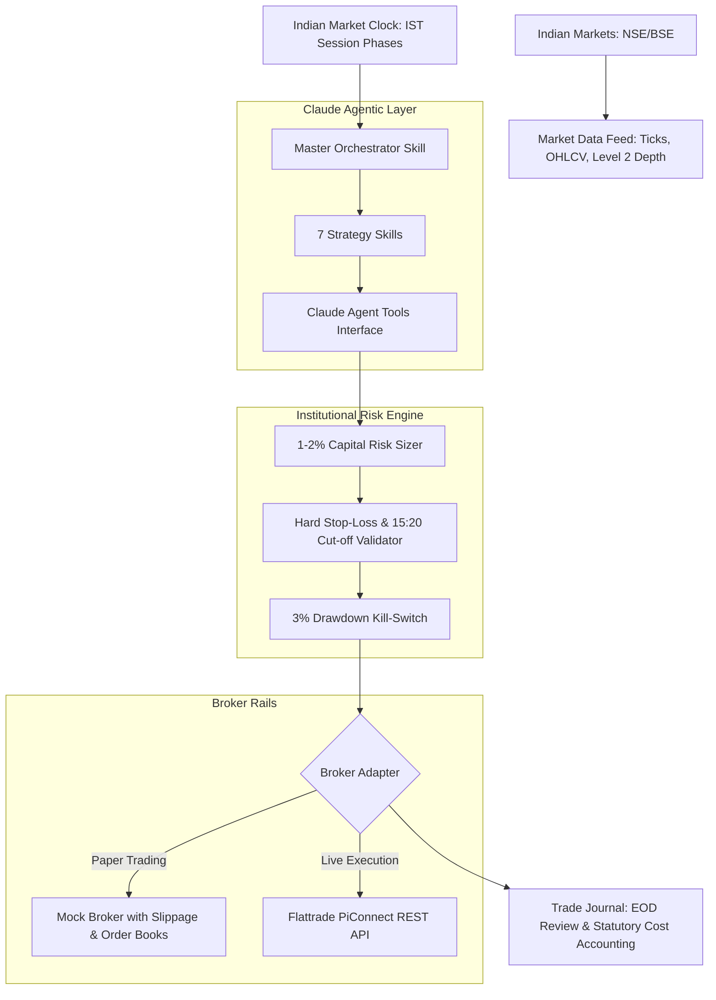

# Indian Markets Intraday Trading Harness & Claude Agent Skills

An institutional-grade intraday trading harness and agentic AI skill system designed for **Claude** to autonomously trade Indian equities and derivatives (NSE/BSE/NFO) via **Flattrade**'s zero-brokerage platform.

Based on the trading strategies and execution framework detailed in [Flattrade Kosh: Common Intraday Trading Strategies Used in Indian Markets](https://flattrade.in/kosh/common-intraday-trading-strategies-used-in-indian-markets/).

---

## 📑 Table of Contents

1. [Architecture Overview](#architecture-overview)
2. [Indian Market Clock & Session Dynamics](#indian-market-clock--session-dynamics)
3. [The 7 Strategy Skills (`SKILL.md`)](#the-7-strategy-skills-skillmd)
4. [Non-Negotiable Risk Management & Flattrade Economics](#non-negotiable-risk-management--flattrade-economics)
5. [Claude Agent Tool Interfaces](#claude-agent-tool-interfaces)
6. [Directory Structure](#directory-structure)
7. [Getting Started & Running Simulations](#getting-started--running-simulations)
8. [Connecting to Live Flattrade Broker](#connecting-to-live-flattrade-broker)

---

## 🏛️ Architecture Overview

The system bridges **Anthropic Claude's Agentic Decision Making** with **Indian Market Microstructure** and broker execution rails:



---

## ⏰ Indian Market Clock & Session Dynamics

Indian markets operate on a distinct three-phase rhythm in Indian Standard Time (IST):

| Time Window (IST) | Market Phase | Strategy Alignment | Rules & Invalidation |
| :--- | :--- | :--- | :--- |
| **09:00 - 09:08** | Pre-Market Auction | Observation & Scan | Scan overnight gaps, earnings, and news catalysts. |
| **09:08 - 09:15** | Transition Buffer | Planning | Build candidate watchlist, establish initial levels. |
| **09:15 - 10:15** | Opening Volatility Surge | **Momentum Trading**, **Gap and Go** | Highest intraday volatility. Mandatory hard stop-loss. |
| **09:30 - 11:00** | Primary Breakout Window | **Opening Range Breakout (ORB)** | 15-minute range completion. Skip if range > 0.7x ATR. |
| **10:15 - 13:30** | Midday Consolidation | **VWAP Pullback Bounce**, **Breakouts** | Volume contracts. Look for institutional support at VWAP. |
| **13:30 - 14:30** | Afternoon Resumption | **Breakouts**, **Reversals** | European open sentiment infusion; volume re-accelerates. |
| **14:30 - 15:15** | Final Square-Off Wave | **Scalping**, **Momentum Exits** | Position covering pushes directional waves. |
| **15:15 - 15:20** | Mandatory Cut-Off | **NO NEW TRADES** | Square off all open MIS positions to avoid broker charges. |
| **15:20 - 15:30** | Broker Auto Square-Off | Account Locked | Flattrade auto-squareoff occurs. |
| **15:30+** | Post-Market Journal | Review | Compute net PnL after all statutory taxes and fees. |

---

## 🎯 Intraday Strategy Skills (`SKILL.md`)

Each strategy defined in the Flattrade framework is implemented as an agent skill:

### 1. [`skills/momentum-trading/SKILL.md`](skills/momentum-trading/SKILL.md)
- **Concept**: "Surfing the wave" — ride early morning momentum surges triggered by earnings or sector buzz.
- **Indicators**: 5m/15m chart, RSI > 60 (bullish) or < 40 (bearish), RVOL > 2.0x, Price > VWAP.
- **Risk & Stop-Loss**: 0.5% to 1.0% below entry; exit on momentum deceleration or 1:2 R:R.

### 2. [`skills/breakout-trading/SKILL.md`](skills/breakout-trading/SKILL.md)
- **Concept**: Exploits tight consolidation channels when price breaks boundary resistance or support.
- **Indicators**: 15m chart, horizontal S/R with $\ge 3$ touches, range height $\le 1.2\%$, breakout volume $\ge 2.5\times$ average.
- **Risk & Stop-Loss**: Stop-loss strictly placed inside broken boundary. Discretionary exit on range re-entry (Fakeout Shield).

### 3. [`skills/reversal-trading/SKILL.md`](skills/reversal-trading/SKILL.md)
- **Concept**: Mean reversion fading parabolic, overextended price surges and flash drops.
- **Indicators**: 5m RSI $\ge 78-80$ (overbought) or $\le 20-22$ (oversold), Shooting Star / Hammer rejection wicks, volume divergence.
- **Target & SL**: Target is return to intraday VWAP (fair value benchmark). Stop-loss 1 tick above exhaustion wick.

### 4. [`skills/vwap-trading/SKILL.md`](skills/vwap-trading/SKILL.md)
- **Concept**: Institutional fair value benchmark. Bullish when Price > VWAP; Bearish when Price < VWAP.
- **Setup**: Low-volume pullback to VWAP followed by a 5m bounce candle (hammer/pin-bar).
- **Target & SL**: SL placed 0.3% - 0.5% beyond VWAP. Target is Day High / Day Low or Daily Pivots.

### 5. [`skills/scalping/SKILL.md`](skills/scalping/SKILL.md)
- **Concept**: Ultra-fast execution capturing ₹1.50 – ₹4.00 per share with ₹1.00 – ₹1.50 risk on high-liquidity stocks (SBIN, Reliance).
- **Indicators**: 1-minute chart, 9 EMA, Level 2 order book depth ratio $\ge 1.6$ or $\le 0.6$.
- **Cost Factor**: Viable due to Flattrade's ₹0 brokerage model.

### 6. [`skills/gap-and-go/SKILL.md`](skills/gap-and-go/SKILL.md)
- **Concept**: Exploits pre-market overnight gaps ($\ge 1.5\%$) continuing in the gap direction.
- **Setup**: Scanned at 09:08 AM. First 5m candle confirms price acceptance (closes in gap direction). Breakout of 5m high triggers entry.
- **Invalidation**: Invalidate trade immediately if price dips below the opening 5m candle low (gap fill risk).

### 7. [`skills/opening-range-breakout/SKILL.md`](skills/opening-range-breakout/SKILL.md)
- **Concept**: The iconic 15-minute Opening Range Breakout (09:15 - 09:30 IST) for Nifty, Bank Nifty, and large-caps.
- **Filter**: Volatility filter skips trade if Opening Range $> 0.70\times$ Daily ATR.
- **Target & SL**: SL at range midpoint. Target is $1.5\times$ to $2.0\times$ the range size.

### 8. [`skills/pivot-vwap-ema/SKILL.md`](skills/pivot-vwap-ema/SKILL.md)
- **Concept**: Directional confluence using Classic Daily Pivot Points, 5-minute VWAP, and the 20 EMA.
- **Confirmation**: Completed bullish/bearish candle closes beyond all three levels with above-average volume; skip extended candles and setups without a 2:1 pivot target.
- **Status**: Skill documentation only; this strategy is not included in the live scanner.

### 9. [`skills/indian-market-trading-master/SKILL.md`](skills/indian-market-trading-master/SKILL.md)
- Master orchestration skill governing daily lifecycle, strategy decision tree, and risk limits.

---

## 🛡️ Non-Negotiable Risk Management & Flattrade Economics

### Core Rules Enforced by `RiskEngine`:
1. **Mandatory Hard Stop-Loss**: No naked positions allowed. Rejects orders without a predefined stop loss.
2. **1% to 2% Capital Risk Sizing**:
   $$\text{Quantity} = \left\lfloor \frac{\text{Capital} \times \text{Risk \%}}{|\text{Entry Price} - \text{Stop-Loss Price}|} \right\rfloor$$
3. **Daily Kill-Switch (3% Drawdown)**:
   Locks the account and blocks new trades if cumulative daily drawdown breaches 3.0%.
4. **15:20 IST Hard Cut-Off**:
   Blocks all fresh orders past 15:20 IST and triggers automated square-off for open MIS contracts.
5. **Zero Brokerage Statutory Levies**:
   Accurately models NSE statutory charges:
   - Brokerage: ₹0.00 (Flattrade)
   - STT: 0.025% on sell turnover
   - Exchange Turnover: 0.00325%
   - GST: 18% on exchange turnover + SEBI fees
   - Stamp Duty: 0.003% on buy turnover
   - SEBI Fee: ₹10 per crore

---

## 🤖 Claude Agent Tool Interfaces

The harness exposes clean JSON-schema tools in `ClaudeAgentInterface` for agentic use:

- `get_market_clock_state`: Returns IST time, session phase, and auto-squareoff alerts.
- `get_market_state(symbol)`: Returns LTP, VWAP, 5m RSI, Day High/Low, and Level 2 depth.
- `scan_market_opportunities(strategy_filter)`: Runs the harness strategies and returns active trade setups.
- `calculate_risk_and_size(symbol, entry_price, stop_loss, risk_pct)`: Returns compliant position size.
- `place_intraday_order(symbol, side, quantity, price, stop_loss, target, strategy, rationale)`: Submits MIS order.
- `get_open_positions()`: Inspects live positions and unrealized PnL.
- `square_off_positions(reason)`: Closes positions immediately.
- `get_trade_journal_summary()`: EOD performance review with net PnL and win-rate.

---

## 📁 Directory Structure

```
c:\work\
├── skills\
│   ├── momentum-trading\SKILL.md
│   ├── breakout-trading\SKILL.md
│   ├── reversal-trading\SKILL.md
│   ├── vwap-trading\SKILL.md
│   ├── scalping\SKILL.md
│   ├── gap-and-go\SKILL.md
│   ├── opening-range-breakout\SKILL.md
│   └── indian-market-trading-master\SKILL.md
│
├── trading_harness\
│   ├── __init__.py
│   ├── config.py                  # Account, risk, session, and tax configurations
│   ├── clock.py                   # Indian Market Clock (IST) and session phase manager
│   ├── indicators.py              # High-performance VWAP, RSI, ATR, EMA, Candle patterns
│   ├── risk_engine.py             # 1-2% sizing, 15:20 cut-off, stop-loss & kill switch
│   ├── journal.py                 # Trade Journal (JSON/CSV) and EOD performance review
│   ├── runner.py                  # End-to-end simulated session runner
│   ├── claude_agent_interface.py  # Claude Tool schemas & execution dispatcher
│   ├── broker/
│   │   ├── base.py                # Abstract Broker Interface
│   │   ├── mock_broker.py         # Simulated execution with slippage & auto square-off
│   │   └── flattrade_broker.py    # Production Flattrade PiConnect REST API client
│   ├── market_data/
│   │   └── feed.py                # OHLCV, Level 2 depth, and pre-market gap generator
│   ├── strategies/
│   │   ├── base_strategy.py
│   │   ├── momentum.py
│   │   ├── breakout.py
│   │   ├── reversal.py
│   │   ├── vwap.py
│   │   ├── scalping.py
│   │   ├── gap_and_go.py
│   │   └── orb.py
│   └── tests/
│       └── test_harness.py        # Complete test suite
│
├── logs/                          # Generated trade journals & logs
└── README.md
```

---

## 🚀 Getting Started & Running Simulations

### 1. Run the Unit Test Suite
```bash
python -m unittest discover -s trading_harness/tests -p "test_*.py" -v
```

### 2. Run the Full Simulated Intraday Session
```bash
python -m trading_harness.runner
```

Output:
```
================================================================================
[START] INDIAN INTRADAY TRADING HARNESS (AGENTIC CLAUDE MODE)
Capital: INR 100,000.00 | Broker: MOCK (Zero Brokerage)
Risk Cap: 1.5% per trade | MIS Cut-off: 15:20 IST
================================================================================

[PHASE 1] 09:18 IST - MORNING_VOLATILITY
Scanning Pre-market Gaps & Morning Momentum...
Pre-open scan found 4 gappers. Top pick: TATAMOTORS (+3.00%) - Record quarterly EV sales
Executed Order 1: BUY 166 TATAMOTORS @ INR 985.0 | SL: INR 976.0 | Tgt: INR 1003.0 [Status: COMPLETE]

[PHASE 2] 09:35 IST - MORNING_VOLATILITY
Evaluating 15-minute Opening Range on NIFTY 50 Futures...
Executed Order 2: BUY 22 NIFTY_FUT @ INR 22460.0 | SL: INR 22425.0 | Tgt: INR 22530.0 [Status: COMPLETE]

[PHASE 3] 11:30 IST - MIDDAY_CONSOLIDATION
Monitoring VWAP Pullback Bounce on INFY...
Executed Order 3: BUY 250 INFY @ INR 1492.0 | SL: INR 1486.0 | Tgt: INR 1505.0 [Status: COMPLETE]

[SIMULATING INTRADAY PRICE ACTION]
TATAMOTORS price reached INR 1003.0 -> Target Hit! Position Closed.
NIFTY_FUT price reached INR 22530.0 -> Target Hit! Position Closed.

[PHASE 4] 15:20 IST - MANDATORY_SQUARE_OFF
[CUT-OFF] 15:20 IST REACHED - Enforcing Mandatory MIS Auto Square-off for remaining open positions...
Auto-Squared Off: INFY @ INR 1498.0 (Reason: 15:20_MIS_AUTO_SQUAREOFF)

================================================================================
[EOD REPORT] END OF DAY TRADING PERFORMANCE SUMMARY
================================================================================
Total Completed Trades: 3
Gross Realized PnL:     INR +5,727.86
Total Statutory Charges: INR 371.78 (STT + Exchange + GST + Stamp Duty)
Net Realized PnL:       INR +5,356.08
Win Rate:               100.0%
Profit Factor:          99.0
================================================================================
```

---

## 🔌 Connecting to Live Flattrade Broker

To switch from Mock mode to live trading with Flattrade:
1. Obtain your API credentials from the Flattrade PiConnect developer portal.
2. Initialize `FlattradeBroker`:
```python
from trading_harness.broker.flattrade_broker import FlattradeBroker

broker = FlattradeBroker(
    user_id="FT012345",
    api_key="your_api_key",
    api_secret="your_api_secret"
)

# Authenticate with TOTP
broker.authenticate(totp_code="123456")
```
3. Pass `broker` into `TradingHarness` or `ClaudeAgentInterface`.

---

## 📡 Live NSE 3-Minute Data Collector & Archiver

The harness includes a built-in automated scraper ([`trading_harness/market_data/nse_live_collector.py`](file:///c:/work/trading_harness/market_data/nse_live_collector.py)) that connects to the official NSE website, grabs live data for the **NIFTY 50 Index and all 50 constituent stocks**, appends snapshots to a date-stamped intraday file, and moves completed dates to an archive folder. The Streamlit dashboard automatically polls every 5 minutes during market hours; the standalone collector CLI retains its configurable 3-minute default.

### 1. File Lifecycle & Storage
- **Daily Live Snapshot File**: `data/live/nifty50_YYYY-MM-DD.csv`
  - While the dashboard is running during market hours, snapshots of all 51 items (1 index + 50 stocks) are appended on fixed 5-minute clock marks (`:00`, `:05`, `:10`, etc.) with `snapshot_ist` timestamps.
- **Latest Query Cache**: [`data/live/nifty50_latest.json`](file:///c:/work/data/live/nifty50_latest.json)
  - High-speed JSON cache updated continuously for sub-millisecond retrieval by Claude or trading strategies.
- **End-of-Day (EOD) Archive**: `data/archive/nifty50_YYYY-MM-DD.csv`
  - The current date's file remains available after the market closes and is archived when a later date starts. If the app was offline, it archives completed-day files on the next startup. `Archive EOD` can archive the current date manually.
  - Each new trading date writes to a new date-stamped file; snapshots are not carried into the next day's file.

### 2. Running the Collector CLI
```bash
# Start continuous 3-minute loop (runs 09:15 to 15:30 IST)
python run_nse_collector.py

# Fetch a single 3-minute snapshot right now (force mode for off-market testing)
python run_nse_collector.py --once --force

# Inspect today's live snapshot file status
python run_nse_collector.py --status

# Manually trigger End-Of-Day archive
python run_nse_collector.py --archive-now
```

### 3. Fields Captured for Each Asset
- `snapshot_ist`: Timestamp of snapshot in Indian Standard Time (YYYY-MM-DD HH:MM:SS)
- `symbol`: e.g., `NIFTY 50`, `RELIANCE`, `TCS`, `HDFCBANK`, `INFY`
- `is_index`: `True` for index, `False` for constituent stocks
- `company_name`: Official listed company name
- `last_price`: Real-time Last Traded Price (LTP)
- `change` & `p_change`: Absolute and percentage change vs previous close
- `open`, `day_high`, `day_low`, `prev_close`: Session OHLC
- `volume` & `total_traded_value`: Traded liquidity
- `year_high` & `year_low`: 52-week extremes
- `nse_timestamp`: NSE exchange broadcast time

---

## 🖥️ Streamlit Real-Time Strategy Scanner App

An interactive web dashboard ([`app.py`](file:///c:/work/app.py)) that automatically polls NSE every 5 minutes during market hours, then checks the available snapshots against enabled strategies whenever the dashboard refreshes.

### 1. Launching the Application
```bash
python -m streamlit run app.py
```
Open **`http://localhost:8501`** in your browser.

### 2. Key Dashboard Capabilities
- **Constituent Watchlist Selector**:
  - Quick-pick buttons: `Select All 50 + Index`, `Top 10 Heavyweights`, `NIFTY 50 Index Only`, `Clear All`.
  - Multi-select dropdown to pick exactly which stocks you want to monitor.
- **Automated Trade Setup Detection**:
  - Probes every selected stock against the eight scanner strategies.
    - Supply & Demand uses 1–5 candle bases, volatility/volume-qualified departures, confirmed swing breaks, zone retests, confirmation candles, and a 2:1 minimum reward-to-risk target.
    - It analyzes complete 5-minute bars and valid 15-minute context. The public NSE snapshot feed does not provide candle OHLCV; the dashboard estimates bars from consecutive sampled prices and cumulative-volume changes and permits explicitly labeled **ESTIMATED** signals. These are experimental: intra-interval prices, highs/lows, and true wicks are unknown, and confidence is capped at MEDIUM. Verified OHLCV remains preferred.
  - Shows compact, timestamped trade alerts with rationale tooltips and retains each alert's original values for the day.
  - Logs each unique daily symbol/strategy/side/entry/target setup to `logs/trade_alerts_YYYY-MM-DD.csv`, including stop, size, confidence, and rationale; completed dates move to `logs/archive/` on the next date.
  - Displays Entry, Hard Stop-Loss, Target, Risk:Reward ratio, and Position Sizing (shares) based on user's capital & 1-2% risk cap.
- **Interactive Technical Charting (Plotly)**:
  - An exploratory 5-minute estimate uses the prior and current sampled LTP for open/close, endpoint-only high/low, and changes in cumulative session volume. Missing intervals are omitted.
  - The chart, VWAP, and indicators are estimates only: they cannot recover intrainterval trades or true wicks and are not inputs to scanner signals. Supply & Demand remains restricted to verified candles.
  - Subplots include estimated Volume/RVOL and 14-period RSI with 70/60/40/30 thresholds.
- **Live NSE Controls**:
  - Automatic NSE polling aligned to fixed 5-minute clock marks during market hours, plus a `Poll NSE` button for an immediate snapshot without shifting the schedule.
  - `Archive EOD` button to move the current day's snapshot and trade-call files to their archive folders.
  - Auto-refresh toggle (10s, 30s, 60s, 180s).
