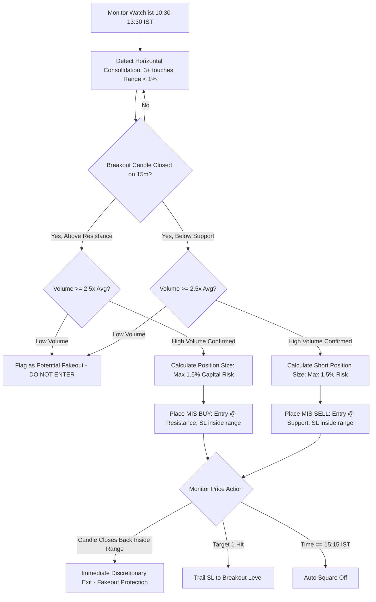

# Breakout Trading Strategy (Indian Intraday Markets)

Based on the Flattrade Indian Intraday Trading framework: **"Every stock moves within a range – a high point and a low point. When it breaks out of that range with volume, it often makes a big move. Breakout traders catch that move."**

---

## 1. Market Mechanics & Consolidation Dynamics

In the Indian trading day, after the initial opening hour (09:15 – 10:15 AM IST), stocks frequently settle into tight horizontal trading ranges during the midday consolidation phase (**10:30 AM – 01:30 PM IST**).
- Liquidity clusters above resistance (buy-stops) and below support (sell-stops).
- A high-volume breach of these levels forces trapped counter-trend traders to cover, creating aggressive directional continuation.

---

## 2. Identification of Valid Consolidation Ranges

To qualify for an intraday breakout setup, the stock must meet all of the following conditions:
1. **Range Definition**: At least 3 touches of resistance and at least 2 touches of support over a minimum window of 60 to 90 minutes.
2. **Volatility Contraction**: The price range (High - Low) should contract to $\le 1.0\%$ of the asset's current price (or $\le 0.5\%$ for Nifty/Bank Nifty).
3. **Volume Dry-up in Range**: Volume within the consolidation channel must show a downward slope (drying liquidity before the surge).

---

## 3. Technical Indicator & Chart Setup

- **Chart Timeframe**: Primary: `15-minute` candlestick chart.
- **Horizontal Support & Resistance Levels**: Clear horizontal boundary levels established during the session.
- **Volume Filter**: Breakout candle volume must be **$\ge 2.5 \times$ to $3.0 \times$** the average 15-minute volume of the preceding range candles.
- **VWAP**: Price must be on the side of the breakout (Above VWAP for long breakouts; below VWAP for breakdowns).

---

## 4. Entry Rules

### Bullish Breakout (Buy)
1. **Trigger Candle**: A 15-minute candle closes decisively **above** the established resistance line.
2. **Volume Confirmation**: The breakout candle's volume is $\ge 2.5\times$ average range volume.
3. **Entry Execution**:
   - Aggressive: Enter immediately upon the 15-minute candle closing above resistance.
   - Conservative: Wait for a 5-minute retest of the broken resistance level (which now acts as support) and enter on the first green candle bounce.
4. **Order Type**: MIS Buy Order with predefined Stop-Loss.

### Bearish Breakdown (Short Sell)
1. **Trigger Candle**: A 15-minute candle closes decisively **below** the established horizontal support.
2. **Volume Confirmation**: Heavy selling volume ($\ge 2.5\times$ average range volume).
3. **Entry Execution**: MIS Sell order on candle close or upon retest rejection of broken support.

---

## 5. Exit, Stop-Loss & Risk Management

1. **Stop-Loss Placement (The Fakeout Shield)**:
   - For Buy Breakout: Place SL strictly **just below the broken resistance level** (typically inside the prior range by 0.2% - 0.4% or below the low of the breakout candle).
   - For Breakdown: Place SL strictly **just above the broken support level**.
   - *Rule*: If the stock slips back inside the consolidation range, the breakout has failed ("fakeout"). Exit immediately without waiting for full SL hit.
2. **Profit Targets**:
   - **Target 1**: Distance equal to the height of the consolidation range projected from the breakout point (e.g., if Range = ₹20, Target = Breakout + ₹20).
   - **Target 2**: Next major Daily Pivot level (R1/R2 or S1/S2) or previous day's high/low.
   - Minimum Risk-to-Reward ratio: **1:2**.
3. **Intraday Square-off**:
   - Exit by **15:15 - 15:20 IST** at the latest.

---

## 6. Claude Agent Execution Protocol



### Actionable Commands for Claude Agent:
```python
# 1. Fetch range analysis
range_data = tools.detect_consolidation(symbol="RELIANCE", timeframe="15m")

if range_data["is_consolidating"] and range_data["touches"] >= 3:
    resistance = range_data["resistance"] # e.g. 2820.0
    support = range_data["support"]       # e.g. 2800.0
    
    current_candle = tools.get_current_candle(symbol="RELIANCE", timeframe="15m")
    
    # Check Breakout condition
    if current_candle["close"] > resistance and current_candle["volume_ratio"] >= 2.5:
        entry = current_candle["close"]
        sl = round(resistance * 0.996, 2) # Just below breakout line
        target = round(entry + (resistance - support) * 1.5, 2)
        
        pos_size = tools.calculate_position_size(
            capital=account.capital,
            risk_pct=0.015,
            entry=entry,
            stop_loss=sl
        )
        
        tools.place_order(
            symbol="RELIANCE",
            side="BUY",
            product="MIS",
            quantity=pos_size,
            price=entry,
            stop_loss=sl,
            target=target,
            strategy="breakout_trading"
        )
```

---

## 7. Failure Modes & Edge Cases

- **The Bull Trap / Fakeout**: A common trap in Indian markets where smart money pushes price 2 rupees above resistance to trigger retail buy stops, then slams price back into range. **Defense**: Never compromise on the volume threshold (> 2.5x) and ensure the 15-minute candle fully closes above resistance before execution.
- **Low Liquidity Midday Breakouts**: Avoid stocks where bid-ask spreads widen beyond 0.15% during 12:00 - 13:00 IST.
