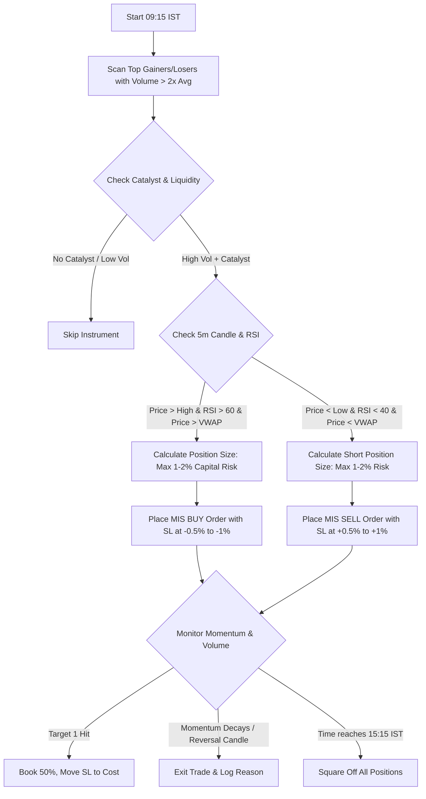

# Momentum Trading Strategy (Indian Intraday Markets)

Based on the Flattrade Indian Intraday Trading framework: **"Momentum trading is riding the wave. When a stock is moving strongly in one direction, jump in and ride that move — then exit before it reverses."**

---

## 1. Market Mechanics & Timing Context

In Indian markets (NSE & BSE), the opening hour (**09:15 AM – 10:15 AM IST**) provides the highest intraday volatility and liquidity. This strategy exploits early-morning volume influx driven by:
- Pre-market block deals and earnings announcements
- Overnight global market cues (e.g., GIFT Nifty, US markets)
- Sector buzz (e.g., Auto numbers, IT quarterly updates, RBI policy announcements)

```
09:00 - 09:08 IST: Pre-market discovery & order matching
09:15 IST: Regular session opens -> High volatility surge
09:15 - 10:00 IST: Optimal Entry Window for Momentum setups
10:15 - 11:30 IST: Momentum decay / consolidation phase (Exit or trail tight)
```

---

## 2. Screening & Universe Selection

Prioritize stocks meeting the following criteria at market open (09:15 - 09:25 IST):
1. **Universe**: High-beta NIFTY 100 or F&O liquid constituents (e.g., TATAMOTORS, RELIANCE, SBIN, INFY, ICICIBANK).
2. **Catalyst Filter**: Pre-market earnings announcement, ratings upgrade, contract win, or heavy sector rotation.
3. **Volume Filter**: 5-minute candle volume > $2.0 \times$ 20-period Average Volume (SMA-20 of volume).
4. **Price Action**: Gapping up/down or breaking out of pre-market high/low.

---

## 3. Technical Indicator Setup

- **Chart Timeframe**: Primary: `5-minute`; Trend confirmation: `15-minute`.
- **RSI (14-period)**:
  - **Bullish Momentum**: RSI > 60 and rising.
  - **Bearish Momentum (Short)**: RSI < 40 and falling.
- **Volume**: Relative Volume ($RVOL > 2.0$) confirming institutional participation.
- **VWAP**: Price must be trading above VWAP for Longs, below VWAP for Shorts.

---

## 4. Entry Rules

### Bullish (Long) Setup
1. **Time**: Between 09:18 and 10:00 AM IST.
2. **Trigger**: Stock breaks above the high of the first 5-minute or 15-minute candle with heavy volume.
3. **Indicator Confluence**:
   - 5-minute RSI is crossing or sustained above 60.
   - Price is strictly above intraday VWAP.
   - 5-min volume bar is noticeably larger than pre-market/previous day bars.
4. **Order Execution**: Place an **MIS (Margin Intraday Square-off)** BUY Limit order at the breakout level or market if liquidity is dense.

### Bearish (Short) Setup
1. **Time**: Between 09:18 and 10:00 AM IST.
2. **Trigger**: Stock breaks below the low of the first 5-minute or 15-minute candle with high volume.
3. **Indicator Confluence**:
   - 5-minute RSI is below 40.
   - Price is strictly below intraday VWAP.
   - Volume surge confirms heavy selling.
4. **Order Execution**: Place an **MIS** SELL (short) order.

---

## 5. Exit & Risk Management

1. **Hard Stop-Loss (Mandatory)**:
   - For Longs: Place SL at $0.5\% \text{ to } 1.0\%$ below entry price, or right below the low of the breakout candle.
   - For Shorts: Place SL at $0.5\% \text{ to } 1.0\%$ above entry price, or above the high of the breakdown candle.
2. **Profit Targets**:
   - **Target 1**: 1:1.5 Risk-Reward ratio (book $50\%$ quantity, move stop-loss to Breakeven).
   - **Target 2**: 1:2 to 1:2.5 Risk-Reward ratio (trail remaining position).
3. **Momentum Decay Exit Trigger**:
   - Exit immediately if volume dries up and a reversal/exhaustion candle appears (e.g., Doji, Shooting Star, Bearish Engulfing).
   - Exit if RSI drops back below 55 (for long) or climbs above 45 (for short).
4. **Intraday Hard Cut-off**:
   - All positions must be closed before **15:20 IST** to avoid broker auto-square-off charges.

---

## 6. Claude Agent Execution Workflow



### Actionable Commands for Claude Agent:
```python
# 1. Fetch market state
state = tools.get_market_state(symbol="TATAMOTORS")

# 2. Check technical confluence
if state["price"] > state["day_high"] and state["rsi_5m"] > 60 and state["volume_ratio"] > 2.0:
    entry = state["ltp"]
    stop_loss = round(entry * 0.992, 2) # 0.8% stop loss
    risk_amount = account.capital * 0.015 # 1.5% max risk
    quantity = int(risk_amount / (entry - stop_loss))
    
    # Place MIS Order with Stop Loss
    order = tools.place_order(
        symbol="TATAMOTORS",
        side="BUY",
        product="MIS",
        quantity=quantity,
        price=entry,
        stop_loss=stop_loss,
        target=round(entry + (entry - stop_loss) * 2, 2),
        strategy="momentum_trading"
    )
```

---

## 7. Edge Cases & Precautions

- **Sudden Reversal**: Momentum in Indian markets can snap quickly if an institutional seller absorbs retail buy orders. Never enter without a live stop-loss order placed in the exchange book.
- **Mid-day Trap**: Do not initiate fresh momentum trades between **11:30 AM and 01:30 PM IST** (lunch hour chop).
- **Earnings Volatility**: If spread is wider than 0.1%, wait for spread compression before firing orders.
