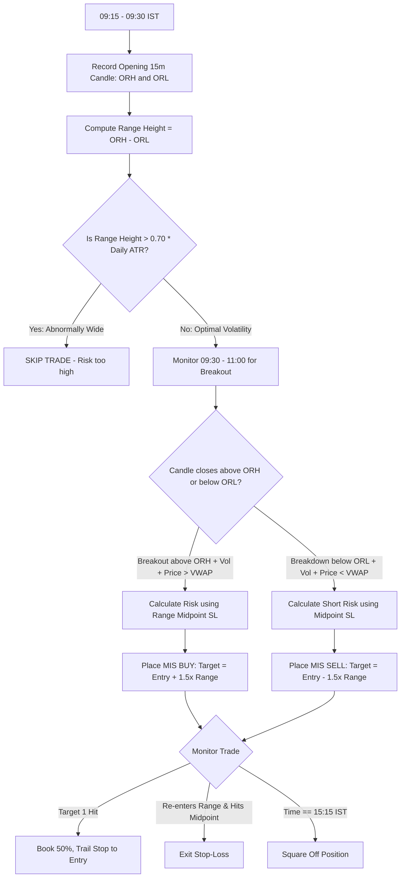

# Opening Range Breakout (ORB) Strategy (Indian Intraday Markets)

Based on the Flattrade Indian Intraday Trading framework: **"One of the most popular intraday strategies in India. The high and low of the first 15 or 30 minutes of trading establish the day's opening range. When price breaks out of this range with volume, trade aggressively in that direction."**

---

## 1. Mechanics of the Indian Market Opening Range

In Indian markets:
- The opening 15 minutes (**09:15 AM – 09:30 AM IST**) absorb the opening bell chaos, pre-market matching backlog, and foreign institutional initial positioning.
- By 09:30 AM, the market defines its initial equilibrium:
  - **ORH (Opening Range High)**: Highest price between 09:15:00 and 09:29:59.
  - **ORL (Opening Range Low)**: Lowest price between 09:15:00 and 09:29:59.
  - **OR Size (Range Height)**: $\text{ORH} - \text{ORL}$.

---

## 2. Volatility Filtering (The Wide-Range Trap Defense)

> **Flattrade Article Warning**: *"The opening range can be abnormally wide on volatile days, making the risk too large. On such days, skip the trade or use midpoint stop-losses."*

Before trading any ORB signal, evaluate the **Range Ratio**:
1. Compute the Average True Range (14-day ATR) for the symbol.
2. If $\text{OR Size} > 0.70 \times \text{Daily ATR}$ (or $> 1.2\%$ for stocks, $> 120$ points for Nifty), **DO NOT TRADE FULL-RANGE ORB**. The risk is too wide, and upside is statistically limited.
3. If $\text{OR Size} < 0.20 \times \text{Daily ATR}$, the range is too narrow (chop alert); wait for 30-min range (09:15 – 09:45 IST).
4. **Optimal Sweet Spot**: $\text{OR Size}$ between $0.25 \times \text{ATR}$ and $0.55 \times \text{ATR}$.

---

## 3. Entry Rules

### Bullish ORB (Buy / Long)
1. **Trigger Window**: 09:30 AM to 11:00 AM IST (Disregard breakouts occurring after 11:30 AM).
2. **Signal Candle**: A 5-minute or 15-minute candle closes decisively **above ORH**.
3. **Volume Confirmation**: The breakout candle's volume must be higher than the average volume of the opening candles.
4. **VWAP Confluence**: Current price and ORH must both be above intraday VWAP.
5. **Execution**: Place an MIS BUY order at candle close or on a 1-tick breakout above candle high.

### Bearish ORB (Sell Short)
1. **Signal Candle**: A 5-minute or 15-minute candle closes decisively **below ORL**.
2. **Volume Confirmation**: Elevated selling volume.
3. **VWAP Confluence**: Current price and ORL must both be below intraday VWAP.
4. **Execution**: Place an MIS SELL order upon breakdown.

---

## 4. Stop-Loss & Target Rules

1. **Stop-Loss Options**:
   - **Standard ORB SL**: Opposite side of opening range (ORL for Long, ORH for Short). Suitable when OR size is tight ($\le 0.35 \times \text{ATR}$).
   - **Midpoint / VWAP SL (Recommended for Balanced Risk)**:
     $$\text{SL}_{\text{Long}} = \frac{\text{ORH} + \text{ORL}}{2} \quad \text{or Intraday VWAP}$$
     This halves the capital at risk while offering comfortable breathing room.
2. **Profit Targets**:
   - **Target 1**: $\text{Entry} + (1.0 \times \text{OR Size})$ (book $50\%$ quantity, move SL to breakeven).
   - **Target 2**: $\text{Entry} + (1.5\times \text{ to } 2.0 \times \text{OR Size})$.
3. **Time-Based Exit**:
   - If trade remains flat after 60 minutes with no progression, scratch at cost.
   - Mandatory MIS auto square-off prior to **15:20 IST**.

---

## 5. Claude Agent Execution Protocol



### Actionable Commands for Claude Agent:
```python
# 09:30 AM IST: Calculate Opening Range for NIFTY Futures
orb = tools.get_opening_range(symbol="NIFTY_FUT", start_time="09:15", end_time="09:30")
orh = orb["high"]
orl = orb["low"]
or_size = orh - orl
daily_atr = tools.get_daily_atr(symbol="NIFTY_FUT", period=14)

# Volatility Filter
if or_size <= 0.65 * daily_atr:
    current = tools.get_market_state(symbol="NIFTY_FUT")
    
    # Check Breakout Above ORH
    if current["ltp"] > orh and current["ltp"] > current["vwap"]:
        entry = current["ltp"]
        midpoint_sl = round((orh + orl) / 2, 2)
        target = round(entry + (1.5 * or_size), 2)
        
        pos_size = tools.calculate_position_size(
            capital=account.capital,
            risk_pct=0.015,
            entry=entry,
            stop_loss=midpoint_sl
        )
        
        tools.place_order(
            symbol="NIFTY_FUT",
            side="BUY",
            product="MIS",
            quantity=pos_size,
            price=entry,
            stop_loss=midpoint_sl,
            target=target,
            strategy="orb_trading"
        )
```

---

## 6. Real-World Indian Market Case Study (from Flattrade Guide)

- **Instrument**: NIFTY 50 Futures
- **09:15 – 09:30 Range**: Low = $22,400$, High = $22,450$ (Range = $50$ points).
- **09:45 AM**: Nifty breaks out above $22,450$ with heavy institutional buying.
- **Entry**: $22,455$.
- **Stop-Loss**: Standard at $22,400$ ($55$ points risk) or Midpoint at $22,425$ ($30$ points risk).
- **Target 1 ($1.5\times$ Range)**: $22,455 + 75 = 22,530$.
- **Target 2 ($2.0\times$ Range)**: $22,455 + 100 = 22,555$.
- **Outcome**: Target 1 achieved at 10:45 AM.
