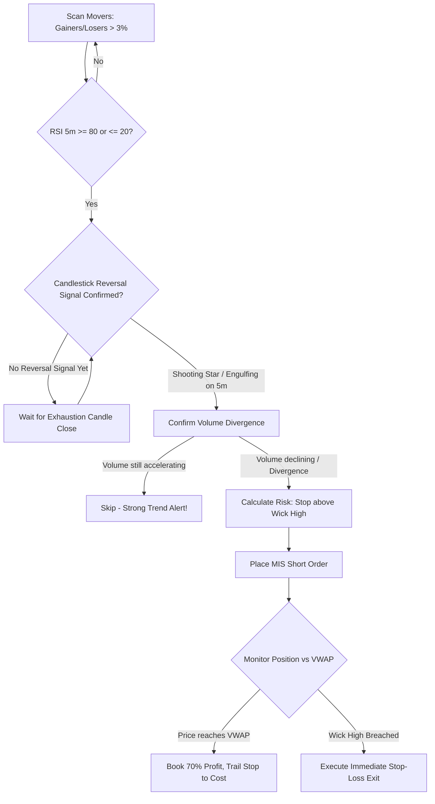

# Reversal Trading (Mean Reversion) Strategy (Indian Intraday Markets)

Based on the Flattrade Indian Intraday Trading framework: **"What goes up too fast, often comes back down – and vice versa. Reversal trading identifies when a stock has moved too far in one direction and bets on it returning to its fair value."**

---

## 1. Market Mechanics & Exhaustion Anatomy

Intraday price action in Indian equities often overshoots due to retail FOMO, rumor chasing, or early morning margin-driven stops. When an asset advances rapidly ($>3\% - 5\%$ in $<30$ minutes) without institutional backing:
- Buying power exhausts at key psychological or technical levels.
- A liquidity void forms beneath the price, creating a fast reversion back toward institutional fair value (**intraday VWAP**).

---

## 2. Exhaustion Identification & Screening Criteria

A valid mean-reversion setup must fulfill all three pillars:
1. **Unsustained Parabolic Move**:
   - Stock surges $\ge 3\%$ or drops $\ge 3\%$ in the first 15–45 minutes with no fundamental/regulatory earnings announcement.
2. **Extreme Momentum Reading**:
   - 5-minute or 15-minute **RSI $\ge 80$** (Extreme Overbought) for Short Reversals.
   - 5-minute or 15-minute **RSI $\le 20$** (Extreme Oversold) for Long Reversals.
3. **Volume Divergence / Exhaustion**:
   - The price reaches a new high (or low), but the corresponding volume bar is markedly **smaller** than the initial thrust volume.

---

## 3. Candlestick Confirmation Signals

Never anticipate a reversal; wait for the market to print an explicit reversal signal candle:
- **Bearish Reversal Signals (Shorts)**:
  - **Shooting Star**: Long upper shadow at least $2\times$ the body size, rejecting high prices.
  - **Bearish Engulfing**: A large red candle that completely engulfs the preceding green candle's body.
  - **Doji / Gravestone Doji**: Signifying complete buyer indecision at the extreme.
- **Bullish Reversal Signals (Longs)**:
  - **Hammer / Dragonfly Doji**: Long lower shadow at least $2\times$ the body size, rejecting lower prices.
  - **Bullish Engulfing**: Large green candle engulfing prior red body.

---

## 4. Entry Rules

### Bearish Exhaustion Short (Overbought Reversal)
1. **Condition**: Stock up $>3\%$ intraday; RSI $\ge 80$; Price far stretched from VWAP ($>2\%$ deviation).
2. **Trigger**: 5-minute candle forms a Shooting Star or Bearish Engulfing pattern.
3. **Entry**: Enter MIS SELL when the low of the rejection candle is breached by the subsequent candle.
4. **Order Type**: MIS Limit or Market Sell.

### Bullish Exhaustion Long (Oversold Bounce)
1. **Condition**: Stock down $>3\%$ intraday; RSI $\le 20$; Price deeply depressed below VWAP.
2. **Trigger**: 5-minute candle forms a Hammer or Bullish Engulfing pattern.
3. **Entry**: Enter MIS BUY when the high of the hammer/reversal candle is breached.
4. **Order Type**: MIS Buy.

---

## 5. Target & Stop-Loss Placement

1. **Tight Stop-Loss (Mandatory & Non-Negotiable)**:
   - For Short: SL placed $1$ tick above the absolute swing high (exhaustion wick high) $+ 0.2\%$.
   - For Long: SL placed $1$ tick below the absolute swing low (exhaustion wick low) $- 0.2\%$.
   - **Maximum Capital Risk**: Restrict risk to $\le 1.0\%$ of trading account equity due to counter-trend risk.
2. **Profit Targets**:
   - **Target 1 (Primary)**: Return to **Intraday VWAP** (institutional fair value benchmark).
   - **Target 2 (Secondary)**: Return to Opening Price (Day Open) or 50% Fibonacci retracement of the morning surge.
   - If price reaches VWAP, book at least $70\%$ position and trail SL to cost.

---

## 6. Claude Agent Execution Protocol



### Actionable Commands for Claude Agent:
```python
state = tools.get_market_state(symbol="LUPIN")

# Evaluate Bearish Reversal Condition
if state["day_change_pct"] >= 3.5 and state["rsi_5m"] >= 80:
    candle = tools.get_candle_pattern(symbol="LUPIN", timeframe="5m")
    
    if candle["pattern"] in ["SHOOTING_STAR", "BEARISH_ENGULFING"]:
        swing_high = candle["high"]
        entry = state["ltp"]
        stop_loss = round(swing_high * 1.002, 2)
        target_vwap = state["vwap"]
        
        # Verify Risk:Reward is at least 1:2
        if (entry - target_vwap) >= 2 * (stop_loss - entry):
            pos_size = tools.calculate_position_size(
                capital=account.capital,
                risk_pct=0.01, # Cap at 1% for counter-trend
                entry=entry,
                stop_loss=stop_loss
            )
            
            tools.place_order(
                symbol="LUPIN",
                side="SELL",
                product="MIS",
                quantity=pos_size,
                price=entry,
                stop_loss=stop_loss,
                target=target_vwap,
                strategy="reversal_trading"
            )
```

---

## 7. Failure Modes & Cautionary Rules

- **Strong Trend Runaway**: If institutional buying is unrelenting (e.g. surprise block deal, buyout buzz), RSI can stay $>80$ for hours while the stock gains another 5%. **Rule**: Never average down on a losing counter-trend trade. If the high is breached, exit immediately without debate.
- **Never Trade Reversals into Earnings Release**: If a company is reporting earnings during market hours, do not fade the move.
