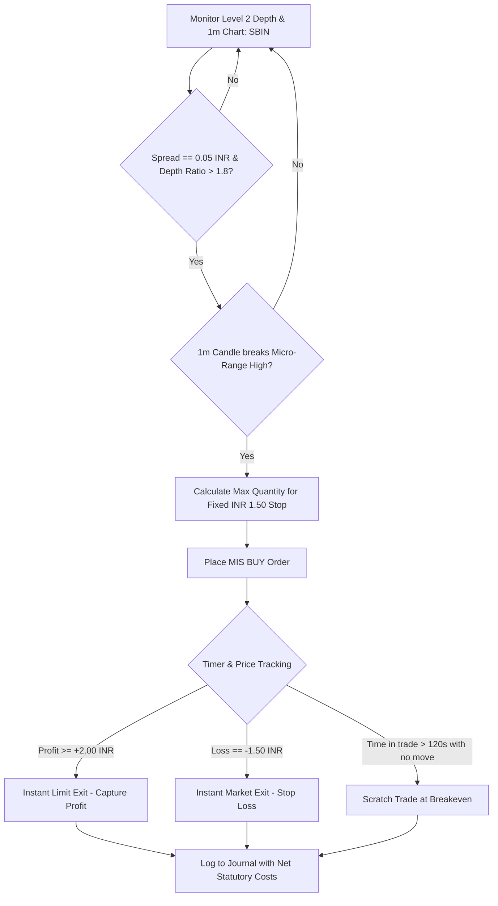

# Scalping Strategy (Indian Intraday Markets)

Based on the Flattrade Indian Intraday Trading framework: **"Scalping is the fastest style of intraday trading. Scalpers target ₹1 to ₹5 of profit per share dozens of times a day. Flattrade's zero-brokerage model makes scalping viable, eliminating per-order brokerage drag."**

---

## 1. Statutory Cost & Zero-Brokerage Economics in India

While Flattrade charges **₹0 brokerage** across all segments, every intraday trade on NSE/BSE is subject to statutory government and exchange levies:
1. **STT (Securities Transaction Tax)**: $0.025\%$ on Sell side for equity intraday.
2. **Exchange Turnover Charges**: NSE charges $\approx 0.00325\%$.
3. **GST (Goods & Services Tax)**: $18\%$ on exchange turnover charges + SEBI fees.
4. **SEBI Turnover Fee**: ₹10 per crore ($0.0001\%$).
5. **Stamp Duty**: $0.003\%$ on Buy side.

> **Scalper's Break-Even Formula**: In liquid large-caps (like SBIN, TATAMOTORS, ICICIBANK priced ₹600–₹1000), total round-trip statutory costs amount to approximately **₹0.20 to ₹0.35 per share**. Any capture $\ge ₹1.00$ yields clean positive net alpha.

---

## 2. Liquidity & Instrument Selection

Restrict scalping exclusively to high-depth instruments with razor-thin bid-ask spreads:
- **Eligible Stocks**: SBIN, RELIANCE, HDFCBANK, ICICIBANK, INFOSYS, TATA MOTORS.
- **Index Instruments**: NIFTY & BANKNIFTY At-The-Money (ATM) weekly options and near-month futures.
- **Spread Constraint**: Max bid-ask spread must be **1 tick (₹0.05 on equities)**. Never scalp illiquid or wide-spread stocks.

---

## 3. Order Book & 1-Minute Micro Technical Signals

- **Chart Timeframe**: `1-minute` candles with 9-period and 21-period Exponential Moving Averages (EMA).
- **Level 2 Market Depth (Order Book)**:
  - **Bid-Ask Ratio**: Total Buy Quantity / Total Sell Quantity in top 5 depth levels.
  - Imbalance $> 1.8$ indicates aggressive buyer absorption (Bullish micro-thrust).
  - Imbalance $< 0.55$ indicates heavy seller overhang (Bearish micro-drop).
- **Tape / Velocity Reading**: Acceleration of executed tick volume at the ask (sweeping the book) confirms instant breakout.

---

## 4. Entry Rules

### Micro-Breakout Scalp (Long)
1. **Setup**: Stock has formed a tight 3 to 5-minute horizontal micro-base (spread $< 0.15\%$).
2. **Trigger**: 1-minute candle breaks the micro-high, accompanied by:
   - Order book bid-to-ask depth ratio $> 1.5$.
   - Price above 9 EMA on 1-minute chart.
3. **Execution**: Immediate MIS Market or Limit order at the best ask.

### Micro-Breakdown Scalp (Short)
1. **Setup**: Stock consolidates against a micro-support line.
2. **Trigger**: 1-minute candle breaks below the micro-low, with bid-to-ask depth $< 0.65$ and price below 9 EMA.
3. **Execution**: Immediate MIS Sell order.

---

## 5. Exit, Stop-Loss & Target Rules

1. **Micro Stop-Loss (Strict & Non-Negotiable)**:
   - For Large-Cap Equities (₹500 - ₹1200): **₹1.00 to ₹2.00 per share** max loss.
   - For Nifty Options: **2.0 to 3.0 premium points**.
   - If the trade does not move in the desired direction within **90 to 120 seconds**, **scratch the trade at cost or -₹0.50**. Do not turn a scalp into a hope trade!
2. **Profit Targets**:
   - Equities: **₹1.50 to ₹4.00 per share** gain.
   - Bank Nifty / Nifty: **8 to 15 points**.
   - Win Rate Target: $60\% - 68\%$.
3. **Frequency & Daily Caps**:
   - Maximum 15 to 25 scalps per day.
   - Max consecutive losses rule: Stop trading for 30 minutes if 3 consecutive scalps fail.

---

## 6. Claude Agent Execution Protocol



### Actionable Commands for Claude Agent:
```python
depth = tools.get_order_depth(symbol="SBIN")
spread = depth["best_ask"] - depth["best_bid"]

if spread <= 0.05 and depth["bid_ask_ratio"] >= 1.8:
    micro_high = tools.get_micro_range(symbol="SBIN", window_minutes=3)["high"]
    
    if depth["best_ask"] >= micro_high:
        entry = depth["best_ask"]
        stop_loss = round(entry - 1.50, 2)
        target = round(entry + 3.00, 2)
        
        # Fixed risk allocation of 1000 INR per scalp
        risk_per_trade = 1000.0
        shares = int(risk_per_trade / (entry - stop_loss))
        
        order = tools.place_order(
            symbol="SBIN",
            side="BUY",
            product="MIS",
            quantity=shares,
            price=entry,
            stop_loss=stop_loss,
            target=target,
            strategy="scalping"
        )
```

---

## 7. Crucial Guardrails for Scalpers

- **Execution Latency**: Scalping requires high-speed API execution. If API response times exceed $300\text{ ms}$, suspend automated scalping.
- **Slippage Control**: Use Limit IOC (Immediate or Cancel) orders or Limit orders with a 1-tick threshold to prevent catastrophic fills during sudden volatility spikes.
- **Statutory Cost Verification**: Always calculate net realized PnL subtracting exchange turnover, SEBI fees, and STT before assessing session profitability.
