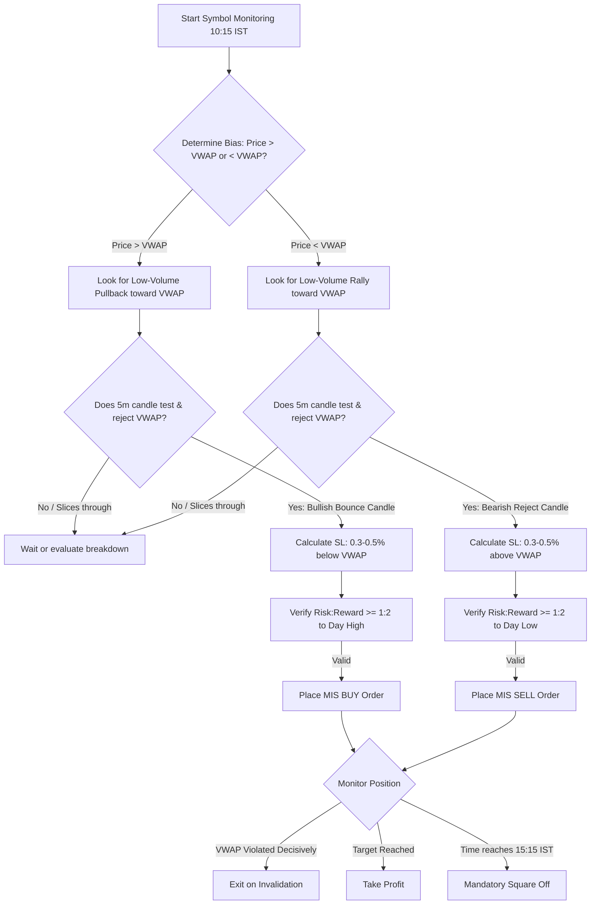

# VWAP Trading Strategy (Indian Intraday Markets)

Based on the Flattrade Indian Intraday Trading framework: **"VWAP is the institutional fair value benchmark. Price above VWAP signifies bullish control; price below VWAP signifies bearish control. When price pulls back to VWAP and bounces, that creates a high-probability institutional entry."**

---

## 1. VWAP Mechanics in Indian Trading Sessions

VWAP resets at **09:15 AM IST** every morning and accumulates cumulative price-volume data:
$$\text{VWAP} = \frac{\sum (\text{Typical Price} \times \text{Volume})}{\sum \text{Volume}}$$
where $\text{Typical Price} = \frac{\text{High} + \text{Low} + \text{Close}}{3}$.

- **Institutional Anchor**: Large domestic institutional investors (DIIs like LIC, mutual funds) and foreign portfolio investors (FPIs) benchmark execution quality against VWAP.
- **Stabilization Window**: VWAP is noisy during the first 15–30 minutes. High-probability VWAP bounce trades emerge between **10:15 AM and 02:30 PM IST**.

---

## 2. Setup Types: The VWAP Pullback Bounce & Cross

### Setup A: Bullish VWAP Pullback Bounce (Long)
1. **Trend Context**: Stock opened strong, advanced above VWAP, establishing clear intraday higher highs.
2. **The Pullback**: Between 10:15 AM and 01:30 PM, the stock enters a low-volume retracement back towards VWAP.
3. **The Bounce Confirmation**:
   - Price tests VWAP (touches or comes within $0.15\%$ of VWAP).
   - A 5-minute candle rejects lower prices at VWAP (prints a hammer, bullish pin bar, or green bullish candle closing above VWAP).
   - Relative volume expands on the bounce candle.

### Setup B: Bearish VWAP Pullback Rejection (Short)
1. **Trend Context**: Stock is weak, trading consistently below VWAP with intraday lower lows.
2. **The Rally**: A low-volume relief rally pushes price up into VWAP resistance.
3. **The Rejection Confirmation**:
   - Price touches VWAP and fails to cross above it.
   - A 5-minute candle prints a shooting star or bearish reversal candle rejecting VWAP.
   - Volume confirms seller defense at VWAP.

---

## 3. Entry Rules

### Bullish Entry (Buy)
- **Trigger**: Buy when the price breaks above the high of the 5-minute VWAP bounce rejection candle.
- **Confluence**: RSI is above 50 (neutral-to-bullish zone); overall market index (NIFTY/BANKNIFTY) is not in a downtrend.
- **Product Type**: MIS Buy.

### Bearish Entry (Sell Short)
- **Trigger**: Sell when price breaks below the low of the 5-minute VWAP rejection candle.
- **Confluence**: RSI is below 50; overall market sentiment is neutral to weak.
- **Product Type**: MIS Sell.

---

## 4. Stop-Loss & Target Rules

1. **Stop-Loss Placement**:
   - For Longs: Place Stop-Loss strictly **$0.3\% \text{ to } 0.5\%$ below the VWAP line** (or below the low of the bounce candle).
   - For Shorts: Place Stop-Loss strictly **$0.3\% \text{ to } 0.5\%$ above the VWAP line** (or above the high of the rejection candle).
2. **Profit Targets**:
   - **Target 1**: Day's current high (for Longs) or Day's current low (for Shorts) — typically achieving 1:1.5 to 1:2 R:R.
   - **Target 2**: Daily Resistance/Support Pivot levels (R1/S1 or R2/S2).
3. **Choppiness Invalidation Rule**:
   - If price cuts back and forth across VWAP more than $3$ times in 30 minutes, **kill the trade or skip the symbol**. VWAP fails in sideways chop.

---

## 5. Claude Agent Execution Protocol



### Actionable Commands for Claude Agent:
```python
state = tools.get_market_state(symbol="INFY")

ltp = state["ltp"]
vwap = state["vwap"]

# Bullish Pullback Bounce Check
if state["day_trend"] == "BULLISH" and abs(ltp - vwap) / vwap <= 0.002: # within 0.2% of VWAP
    candle = tools.get_current_candle(symbol="INFY", timeframe="5m")
    
    if candle["close"] > candle["open"] and candle["low"] <= vwap and candle["close"] > vwap:
        entry = candle["close"]
        sl = round(vwap * 0.996, 2) # 0.4% below VWAP
        day_high = state["day_high"]
        
        if (day_high - entry) >= 1.5 * (entry - sl):
            pos_size = tools.calculate_position_size(
                capital=account.capital,
                risk_pct=0.015,
                entry=entry,
                stop_loss=sl
            )
            
            tools.place_order(
                symbol="INFY",
                side="BUY",
                product="MIS",
                quantity=pos_size,
                price=entry,
                stop_loss=sl,
                target=day_high,
                strategy="vwap_trading"
            )
```

---

## 6. Edge Cases & Market Nuances

- **The Sideways Market Whip**: When NIFTY is consolidating with low volatility (e.g. India VIX $< 11$), VWAP flattens and price weaves through it repeatedly. **Detection**: Measure the angle/slope of VWAP. If slope $\approx 0$ for 45 minutes, disable VWAP signals on equities.
- **Institutional Market Close Flow**: Between **02:45 PM and 03:15 PM**, mutual funds execute VWAP guarantee orders to match benchmark closing prices. Expect sudden volume spikes toward VWAP.
